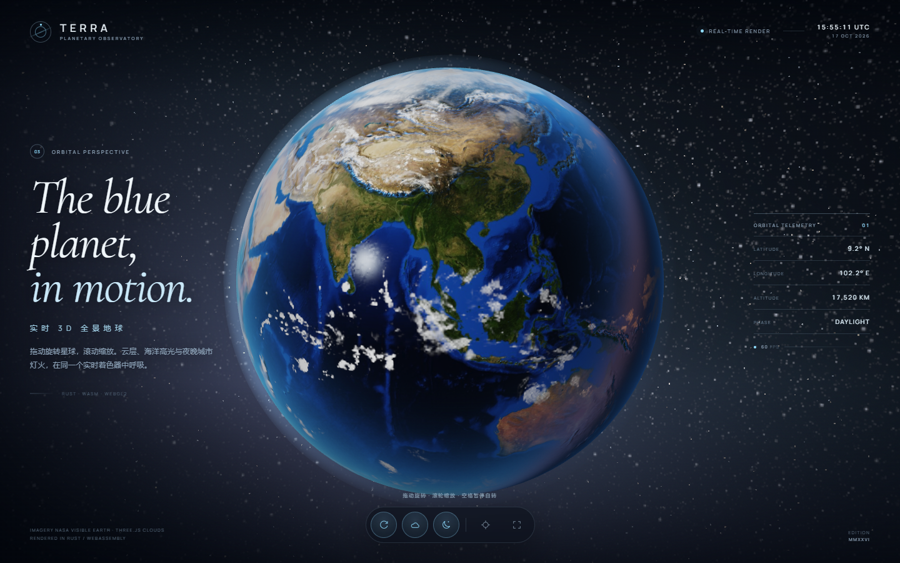
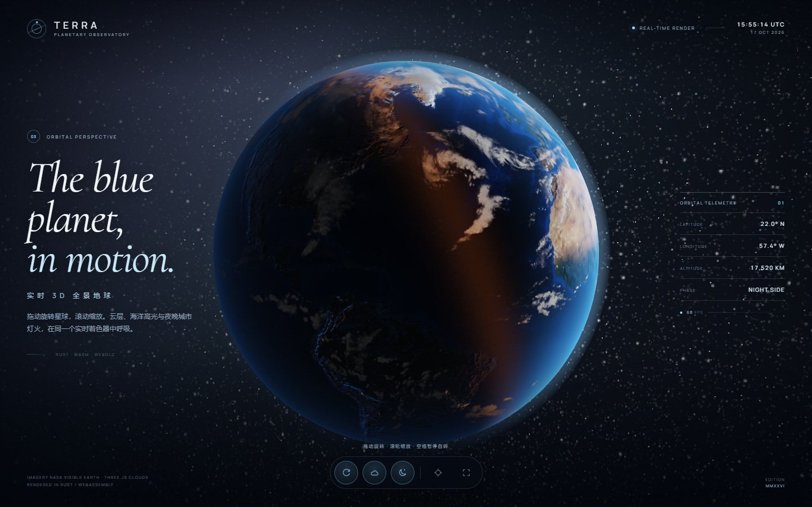

# TERRA — Rust / WebAssembly 3D 全景地球

一个由 **Rust + WebAssembly + WebGL2** 实现的实时 3D 地球。没有 Three.js，也没有 JavaScript 渲染胶水层：球体生成、矩阵计算、相机、着色器、纹理上传和交互全部在 Rust 中完成。



越过晨昏线后，城市灯光与夜面大气依旧清晰可见：



## 特性

- **完整球面地球**：192 × 96 段 UV 球体，4096 × 2048 的 NASA Blue Marble 日间影像与 Earth at Night 夜景影像。
- **多层实时材质**：法线贴图地形、海面高光、独立漂移的云层、夜间城市灯光、大气边缘散射。
- **全景深空**：4096 × 2048 星空全景 + 程序化银河辉光。
- **流畅轨道交互**：拖拽旋转、惯性、滚轮缩放、移动端双指缩放。
- **实时 HUD**：视点经纬度、等效轨道高度、昼/夜相位、UTC 时间与 FPS。
- **自适应构图**：桌面端保持电影感近景，竖屏自动扩大视场角以容纳完整地球。
- **自包含**：字体、纹理、WASM 全部本地加载，不依赖 CDN。首次加载约 4 MB。

## 运行

前置要求：Rust 1.80+、Python 3、支持 WebGL2 的现代浏览器。

```bash
# 1. 安装 wasm 编译目标
rustup target add wasm32-unknown-unknown

# 2. 安装与项目严格匹配的 wasm-bindgen CLI
cargo install wasm-bindgen-cli --version 0.2.106 --locked

# 3. 编译 Rust -> WASM，并生成 web/pkg
./scripts/build.sh

# 4. 启动静态服务器
./scripts/serve.sh
# 打开 http://localhost:4173
```

如果 `.tools/` 中存在对应的 `wasm-bindgen` 可执行文件，`build.sh` 会优先使用它。离线构建时：

```bash
TERRA_OFFLINE=1 ./scripts/build.sh
```

## 操作

| 操作 | 功能 |
| --- | --- |
| 拖拽 | 旋转/俯仰观察地球 |
| 滚轮 / 双指捏合 | 缩放 |
| 点击按钮 | 自转、云层、城市灯光、重置、全屏 |
| `Space` | 暂停/恢复地球自转 |
| `C` / `N` | 云层 / 城市灯光 |
| `R` / `F` | 重置视角 / 全屏 |

## 技术结构

```text
src/
├── lib.rs       WASM 入口，WebGL2 上下文与启动错误处理
├── app.rs       应用状态、相机、动画循环、指针/键盘、HUD
├── gl.rs        WebGL2 封装：Program、UV 球体、纹理、渲染通道
├── shaders.rs   GLSL ES 3.00：星空、地球表面、大气层
└── math.rs      Vec3 / Mat4（列主序，直接传入 WebGL）
web/
├── index.html   界面结构
├── style.css    观测台风格 UI、加载动画、响应式布局
├── pkg/         由 wasm-bindgen 生成的 JS + WASM
└── assets/      地球纹理、星空、字体
```

### 渲染通道

1. **星空背景**：全屏三角形，从相机基向量重建视线方向，采样等距柱状星空全景，并叠加程序化银河带与太阳辉光。
2. **地球本体**：UV 球体 + 日间/夜间/水体/云层/法线五张纹理。片元着色器处理太阳直射、海面 Blinn-Phong 高光、云层阴影、晨昏线暖色和城市灯光。
3. **大气层**：略大球体的背面，加法混合。片元着色器根据屏幕空间半径在轮廓外淡出，避免几何边缘出现硬边。

太阳方向是世界空间中的固定光向量，地球模型绕 Y 轴缓慢自转，因此晨昏线会自然地扫过大陆。相机的经纬度读数通过逆转地球自转矩阵得到。

## 素材与许可

代码以 MIT License 发布。

地球纹理来自 NASA Visible Earth / Earth at Night 影像（经 `three-globe` 示例打包），云层与法线贴图来自 `three.js` 示例纹理，星空全景来自 `three-globe` 示例资源。NASA 影像通常属于公有领域；three.js / three-globe 示例资源遵循各自仓库的开源许可。字体为 Google Fonts 的 Manrope 与 Cormorant Garamond（SIL Open Font License）。

这是一个艺术化实时可视化项目，太阳位置与大气效果经过视觉调校，不用于导航或科学计算。
